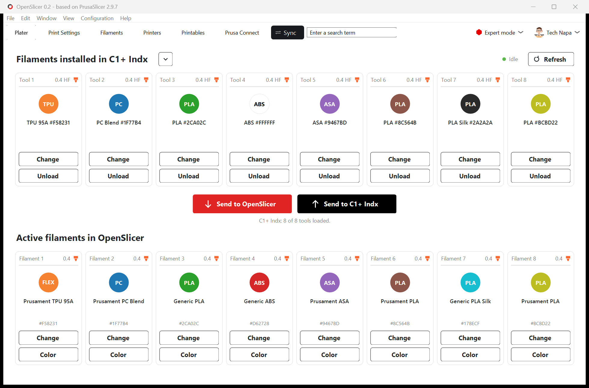
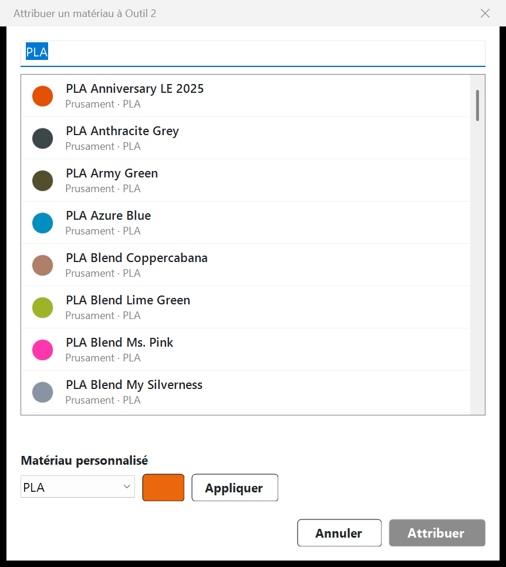
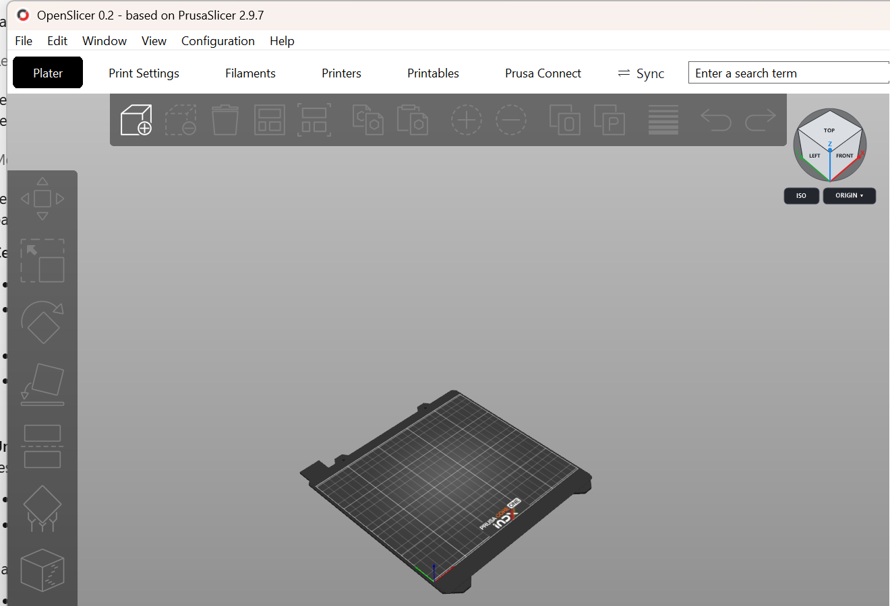

# OpenSlicer

[English](README.md) · **Français**

**OpenSlicer** est une version Windows de [PrusaSlicer](https://github.com/prusa3d/PrusaSlicer) 2.9.7 avec quelques
outils en plus, pensée d'abord pour les possesseurs de la **Prusa CORE One INDX** (multi-outils) :

- **Onglet Sync** : une vraie synchronisation dans les deux sens des filaments entre l'imprimante (via Prusa Connect)
  et le slicer.
- **ViewCube 3D** sur le plateau, pour changer de vue en un clic.
- **Définir l'origine** : la caméra tourne autour de l'objet sélectionné ou autour du plateau, au choix.

Tout le reste est PrusaSlicer, sans modification : même moteur de découpe, mêmes profils, mêmes fichiers projet.

> [!IMPORTANT]
> **Ce projet a été codé en « vibe coding ».** Le code a été co-écrit par des agents IA, sous la direction d'un maker
> qui l'a testé sur sa propre imprimante. Lisez [Comment il a été fait](#comment-il-a-été-fait-vibe-coding) avant de
> l'utiliser ou d'y contribuer.

> OpenSlicer est un projet communautaire, sans lien avec Prusa Research ni approuvé par elle.
> Prusa, PrusaSlicer et Prusa Connect sont des marques de Prusa Research a.s.



---

## État du projet

| | |
|---|---|
| Version | 0.2, expérimentale |
| Plateforme | Windows 10/11 x64 uniquement |
| Base | PrusaSlicer 2.9.7 officiel pour Windows (non recompilé) |
| Testé sur | Une Prusa CORE One INDX (8 outils), firmware 8, Prusa Connect, Windows 11 |
| Téléchargement | Zip portable dans [Releases](https://github.com/technapa/OpenPS/releases) (voir [Installation](#installation)) |

Son auteur l'utilise depuis novembre 2026 et il est stable jusqu'ici, mais personne d'autre ne l'a encore relu ni
testé. Les rapports de bugs sont les bienvenus.

---

## Pourquoi l'onglet Sync ?

Depuis le firmware 8, la CORE One INDX permet d'associer un matériau et une couleur à chacun de ses outils, et Prusa
Connect les affiche dans son onglet *Outils*. PrusaSlicer, lui, ne sait toujours pas lire cette configuration ni y
renvoyer ses propres filaments : il faut tout ressaisir à la main d'un côté ou de l'autre.

L'onglet Sync affiche les deux côtés l'un au-dessus de l'autre, dans le style de l'onglet *Outils* de Prusa Connect :

| Volet | Contenu | Actions |
|---|---|---|
| **Filaments installés dans &lt;imprimante&gt;** | Une carte par outil, lue en direct dans Prusa Connect : matériau, marque, couleur, buse (0.4 HF...), outil dans la tête, poids restant | **Attribuer / Changer** (même catalogue de matériaux que Connect, ou type + couleur personnalisés), **Décharger** |
| **Filaments actifs dans OpenSlicer** | Une carte par filament du profil d'imprimante actif : profil, couleur | **Changer** (profil compatible pour un type de matériau), **Couleur** |

et deux boutons :

- **Envoyer vers OpenSlicer** : outil *N* de l'imprimante → filament *N* du slicer (couleur + profil de filament
  compatible).
- **Envoyer vers &lt;imprimante&gt;** : filament *N* du slicer → outil *N* de l'imprimante dans Prusa Connect. Si un
  matériau du catalogue Connect a la même marque, le même type et la même couleur, il est utilisé ; sinon un matériau
  personnalisé nommé `"<nom> #RRGGBB"` est créé une fois dans votre entrepôt Connect puis réutilisé.

Rien n'est jamais envoyé à l'imprimante sous forme de G-code : OpenSlicer utilise les mêmes appels Prusa Connect que
son application web (voir [API Prusa Connect](doc/openslicer/ARCHITECTURE.md#prusa-connect-api)). Comme Connect
l'indique lui-même, une attribution enregistre quel matériau se trouve sur un outil ; elle ne charge pas le filament
et ne change pas ce qu'affiche l'écran de l'imprimante.

L'onglet fonctionne dans les 21 langues de PrusaSlicer et suit la langue choisie dans *Configuration > Préférences*.



## ViewCube et Définir l'origine



- Cliquez sur une face ou un axe du cube pour regarder de ce côté, **ISO** pour la vue isométrique.
- **ORIGIN** (et *Définir l'origine* en bas des menus contextuels de la vue 3D et de la liste d'objets) :
  - *Centre de l'objet actif* : la caméra pivote autour de l'objet sélectionné et suit la sélection.
  - *Centre du plateau* : retour au comportement de PrusaSlicer.

---

## Votre compte et votre imprimante

OpenSlicer n'agit sur votre compte Prusa et votre imprimante que via Prusa Connect, et seulement quand vous le
demandez :

- **Connexion** : OpenSlicer réutilise la session de PrusaSlicer (Gestionnaire d'identification Windows). Il ne fait
  que **lire** le jeton d'accès, ne l'écrit ni ne le renouvelle jamais, et ne voit jamais votre mot de passe.
- **Lecture** : la liste des imprimantes et les outils sont lus à l'ouverture de l'onglet Sync ou quand vous cliquez
  sur *Actualiser*. Pas d'interrogation en tâche de fond, pas d'accès au réseau local.
- **Écriture** : uniquement *Attribuer / Changer*, *Envoyer vers &lt;imprimante&gt;* (attributions de matériaux,
  matériaux personnalisés dans votre entrepôt) et *Décharger* (seulement quand l'imprimante est au repos). Tout cela
  peut aussi être fait ou défait depuis Prusa Connect.
- **API non documentée** : Prusa Connect n'a pas d'API publique pour cela. OpenSlicer utilise les appels internes de
  l'application web Connect ; si Prusa les modifie, l'onglet Sync peut cesser de fonctionner (sans conséquence pour
  votre compte ni votre imprimante).

---

## Installation

**Zip portable (le plus simple)**

1. Téléchargez `OpenSlicer-0.2-win64.zip` depuis la [dernière version publiée](https://github.com/technapa/OpenPS/releases/latest).
2. Décompressez-le où vous voulez (par exemple `C:\App\`) et lancez `OpenSlicer\OpenPS.exe`. Aucune installation,
   pas besoin de PrusaSlicer : le zip contient le moteur officiel de PrusaSlicer 2.9.7. Windows SmartScreen peut
   avertir d'un éditeur inconnu (le programme n'est pas signé) : *Informations complémentaires > Exécuter quand même*.
3. Réglages, profils et connexion au compte Prusa sont partagés avec PrusaSlicer (`%APPDATA%\PrusaSlicer`).
   Un PrusaSlicer installé continue de fonctionner et peut rester ouvert.
4. Pour l'onglet Sync, connectez-vous une fois à votre compte Prusa dans l'onglet **Prusa Connect**.

**Depuis les sources**

1. Installez [PrusaSlicer 2.9.7](https://github.com/prusa3d/PrusaSlicer/releases/tag/version_2.9.7)
   (OpenSlicer réutilise son `PrusaSlicer.dll` et ses ressources).
2. Compilez OpenSlicer (ci-dessous) avec `-Publish`, puis lancez `OpenPS.exe` depuis le dossier d'installation.

Si `PrusaSlicer.dll` n'est pas la version 2.9.7 Windows x64, OpenSlicer démarre quand même, vous prévient une fois et
désactive les fonctions qui dépendent des rouages internes de PrusaSlicer (ViewCube, Définir l'origine, choix
automatique du profil de filament).

## Compilation

Prérequis : Windows 10/11 x64, Visual Studio 2019 ou plus récent avec *Développement Desktop en C++*,
PowerShell 5+, PrusaSlicer 2.9.7 installé.

```powershell
# compilation seule -> build\openslicer\OpenPS.exe
powershell -ExecutionPolicy Bypass -File scripts\build_launcher.ps1

# compilation et installation dans C:\App\OpenPS (ferme un OpenSlicer lancé depuis ce dossier, jamais de force)
powershell -ExecutionPolicy Bypass -File scripts\build_launcher.ps1 -Publish -InstallDir C:\App\OpenPS
```

Pour fabriquer le zip portable : `powershell -ExecutionPolicy Bypass -File scripts\package_release.ps1 -Version 0.2`.

Le lanceur est une seule unité de compilation C++17 et se compile en quelques secondes. PrusaSlicer lui-même n'est
**pas** recompilé : aucune de ses dépendances (`deps/`) n'est nécessaire.

Les ressources aux couleurs d'OpenSlicer (icônes, écran de démarrage, catalogue français) sont déjà dans
`resources/`. Pour les régénérer depuis une installation de PrusaSlicer :
`python scripts\build_assets_and_loc.py --help` (nécessite Pillow).

## Fonctionnement

`OpenPS.exe` charge le `PrusaSlicer.dll` officiel et appelle son point d'entrée `slic3r_main()`, exactement comme
`prusa-slicer.exe`. Avant cela, il installe quelques hooks d'import et sous-classe des fenêtres de PrusaSlicer pour
ajouter les fonctions d'OpenSlicer ; pour le ViewCube et Définir l'origine, il appelle des fonctions de PrusaSlicer
dont les adresses sont connues pour la version 2.9.7. Détails (en anglais) :
**[doc/openslicer/ARCHITECTURE.md](doc/openslicer/ARCHITECTURE.md)**.

| Chemin | Contenu |
|---|---|
| `src/openps_launcher/` | Tout le code d'OpenSlicer (lanceur, onglet Sync, client Prusa Connect, traductions) |
| `scripts/` | Scripts de compilation, d'installation et de génération des ressources |
| `resources/icons`, `resources/localization/fr` | Ressources installées par-dessus celles de PrusaSlicer |
| `patches/` | Modifications expérimentales pour une compilation complète des sources (non utilisées par le lanceur) |
| `doc/openslicer/` | Documentation développeur (en anglais) |
| tout le reste | Sources de PrusaSlicer 2.9.7, intactes ([README d'origine](doc/PrusaSlicer-README.md)) |

L'historique git conserve tout l'historique de PrusaSlicer jusqu'au tag `version_2.9.7` ; OpenSlicer, ce sont les
commits par-dessus.

---

## Comment il a été fait (vibe coding)

OpenSlicer a été **codé en « vibe coding »** : son auteur ([Tech Napa](https://github.com/technapa), maker et
youtubeur impression 3D, pas développeur C++ professionnel) a décrit les fonctions, testé chaque version sur une vraie
imprimante et signalé ce qui n'allait pas ; des agents IA ont écrit le code.

- **Prototype** : [Google Antigravity](https://antigravity.google/) (Gemini). Il a produit le premier lanceur, le
  premier onglet Sync et le ViewCube. La synchro fonctionnait de l'imprimante vers le slicer, mais dans l'autre sens
  elle envoyait un fichier G-code que l'imprimante exécutait comme une impression et qui réécrivait ses réglages de
  filament par outil.
- **Réécriture et nettoyage** : [Claude Code](https://claude.com/claude-code) (Claude Opus). Il a réécrit entièrement
  l'onglet Sync et son client Prusa Connect (style Connect, attributions par les mêmes appels GraphQL que
  l'application web Connect, aucun G-code, session en lecture seule), traduit chaque texte ajouté dans les 21 langues,
  ajouté la vérification de la version de la DLL, les scripts de compilation et cette documentation. Les commits faits
  ainsi portent une ligne `Co-Authored-By: Claude`.
- **Rouages internes de PrusaSlicer** : les adresses de fonctions et la disposition des objets dans
  [`PrusaSlicerDll.hpp`](src/openps_launcher/PrusaSlicerDll.hpp) ont été trouvées par les agents en comparant les
  sources de PrusaSlicer 2.9.7 au désassemblage de la DLL officielle.
- **Appels Prusa Connect** : repris des requêtes de l'application web Connect, pas d'une documentation.

Ce que cela signifie pour vous :

- Le code a été **relu par son auteur, testé sur du vrai matériel et se compile sans avertissement (`/W4`)**, mais
  **aucun développeur C++ ou Windows expérimenté ne l'a encore relu**. Traitez-le comme n'importe quel jeune projet
  amateur.
- **Vérifié** : lecture de l'onglet Sync et *Envoyer vers l'imprimante* / *Envoyer vers OpenSlicer* sur une CORE One
  INDX à 8 outils ; interface en anglais, français, allemand et japonais ; la vérification de la DLL ; ViewCube et
  Définir l'origine avec une mise à l'échelle de 150 %.
- **Pas encore vérifié** : *Décharger* depuis l'onglet Sync, le changement de langue pendant qu'OpenSlicer tourne, les
  autres imprimantes (les imprimantes mono-outil devraient fonctionner mais n'ont pas été essayées), Windows 10.
- Les traductions autres que l'anglais et le français ont été écrites par l'IA sans locuteur natif ; les corrections
  sont les bienvenues ([TRANSLATIONS.md](doc/openslicer/TRANSLATIONS.md)).

Relectures, tests et pull requests humains, assistés par IA ou non, sont les bienvenus. Si vous utilisez un agent IA,
indiquez-le dans votre pull request.

---

## Contribuer

Les issues et pull requests sont les bienvenues. Points d'entrée utiles (en anglais) :

- [Architecture](doc/openslicer/ARCHITECTURE.md) : comment s'articulent le lanceur, les hooks et l'onglet Sync.
- [Traductions](doc/openslicer/TRANSLATIONS.md) : ajouter ou corriger un texte dans les 21 langues.
- [Porter vers une autre version de PrusaSlicer](doc/openslicer/UPDATING_PRUSASLICER.md).

Merci de garder le code en anglais (commentaires et identifiants), de compiler sans avertissement (`/W4`) et
d'ajouter tout nouveau texte visible dans `SyncIndxI18n.hpp`, dans toutes les langues. Ne commitez jamais de jeton, de
clé ni quoi que ce soit venant de votre compte Prusa.

### Limites connues

- Windows x64 uniquement ; PrusaSlicer 2.9.7 uniquement pour le ViewCube et Définir l'origine (voir plus haut).
- Hors français, certains textes de PrusaSlicer disent encore « PrusaSlicer » (seul le catalogue français est
  renommé).
- Les couleurs du slicer sont lues dans les listes de filaments du plateau ; après avoir changé une couleur, ouvrez
  l'onglet Sync depuis le plateau pour qu'elle soit relue.
- L'onglet Sync dépend d'appels Prusa Connect non documentés (voir plus haut).

## Licence

OpenSlicer est un logiciel libre sous **GNU Affero General Public License v3** ([LICENSE](LICENSE)), comme PrusaSlicer.
PrusaSlicer est © Prusa Research et ses contributeurs, basé sur Slic3r d'Alessandro Ranellucci et la communauté
RepRap.
