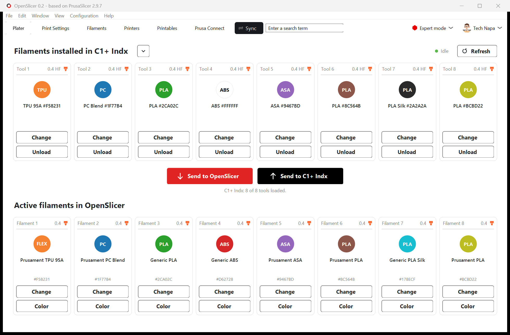
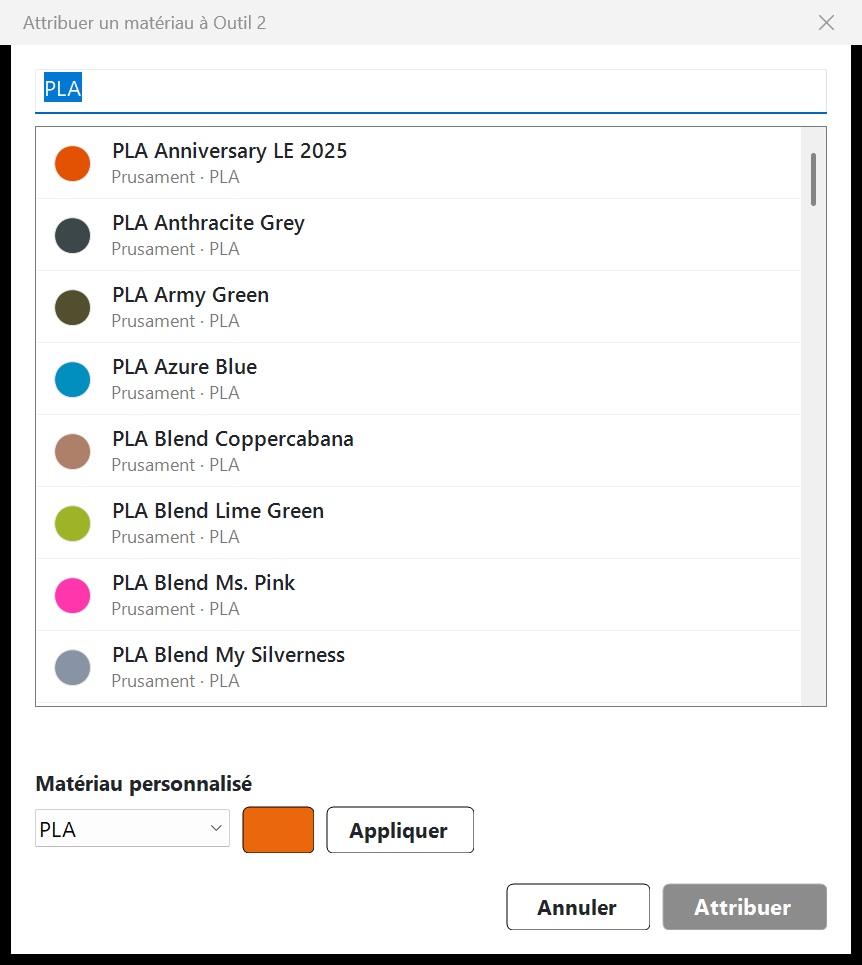
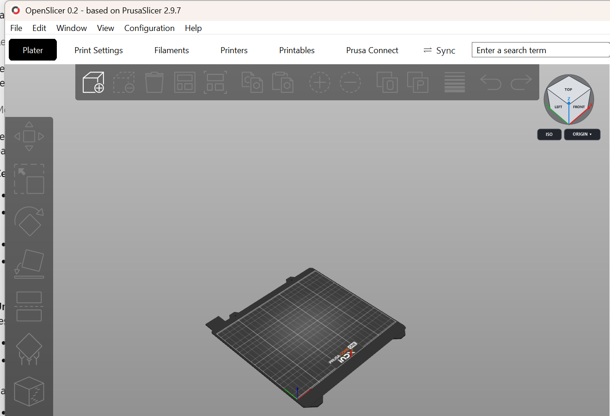

# OpenSlicer

**OpenSlicer** is a Windows build of [PrusaSlicer](https://github.com/prusa3d/PrusaSlicer) 2.9.7 with a few extra tools,
made first for the **Prusa CORE One INDX** (multi-tool) owners:

- **Sync tab**: a real two-way synchronization of filaments between the printer (through Prusa Connect) and the slicer.
- **3D ViewCube** over the plater, to change the view in one click.
- **Set origin**: choose whether the camera orbits around the selected object or around the build plate.

Everything else is PrusaSlicer, unchanged: same slicing engine, same profiles, same project files.

> OpenSlicer is a community project. It is not affiliated with or endorsed by Prusa Research.
> Prusa, PrusaSlicer and Prusa Connect are trademarks of Prusa Research a.s.



---

## Why the Sync tab?

Since firmware 8, the CORE One INDX lets you assign a material and a color to each of its tools, and Prusa Connect
shows them in its *Tools* tab. PrusaSlicer, however, still has no way to read that setup or to send its own filaments
back: you re-enter everything by hand on one side or the other.

The Sync tab shows both sides next to each other, styled like the Prusa Connect *Tools* tab:

| Panel | Content | Actions |
|---|---|---|
| **Filaments installed in &lt;printer&gt;** | One card per tool, read live from Prusa Connect: material, brand, color, nozzle (0.4 HF...), tool in the print head, remaining weight | **Assign / Change** (same material catalogue as Connect, or a custom type + color), **Unload** |
| **Active filaments in OpenSlicer** | One card per filament of the active printer profile: profile, color | **Change** (compatible profile for a material type), **Color** |

and two buttons:

- **Send to OpenSlicer**: tool *N* of the printer → filament *N* of the slicer (color + a compatible filament profile).
- **Send to &lt;printer&gt;**: filament *N* of the slicer → tool *N* of the printer in Prusa Connect. When a Connect
  catalogue material has the same brand, type and color it is used; otherwise a custom material named
  `"<name> #RRGGBB"` is created once in your Connect warehouse and reused.

Nothing is ever sent to the printer as G-code: OpenSlicer uses the same Prusa Connect calls as its web application
(see [Prusa Connect API](doc/openslicer/ARCHITECTURE.md#prusa-connect-api)). As Connect itself explains, an assignment
records which material is on a tool; it does not load filament or change what the printer's own screen displays.

The tab works in the 21 languages of PrusaSlicer and follows the language chosen in *Configuration > Preferences*.



## ViewCube and Set origin



- Click a face or an axis of the cube to look from that side, **ISO** for the isometric view.
- **ORIGIN** (also *Set origin* at the bottom of the 3D view and object list context menus):
  - *Center of active object*: the camera pivots around the selected object and follows the selection.
  - *Center of build plate*: back to the PrusaSlicer behavior.

---

## Installing

OpenSlicer needs **PrusaSlicer 2.9.7 for Windows x64** installed (it reuses its `PrusaSlicer.dll` and resources).

1. Install [PrusaSlicer 2.9.7](https://github.com/prusa3d/PrusaSlicer/releases/tag/version_2.9.7).
2. Build OpenSlicer (below) with `-Publish`, or copy a release folder.
3. Start `OpenPS.exe`. Settings, profiles and the Prusa Account login are shared with PrusaSlicer
   (`%APPDATA%\PrusaSlicer`).
4. For the Sync tab, log in to your Prusa Account in the **Prusa Connect** tab once.

If `PrusaSlicer.dll` is not the 2.9.7 Windows x64 release, OpenSlicer still starts, tells you once, and disables the
features that depend on PrusaSlicer internals (ViewCube, Set origin, automatic filament profile selection).

## Building

Requirements: Windows 10/11 x64, Visual Studio 2019 or newer with *Desktop development with C++*,
PowerShell 5+, PrusaSlicer 2.9.7 installed.

```powershell
# build only -> build\openslicer\OpenPS.exe
powershell -ExecutionPolicy Bypass -File scripts\build_launcher.ps1

# build and install to C:\App\OpenPS (closes a running OpenSlicer from that folder, never forced)
powershell -ExecutionPolicy Bypass -File scripts\build_launcher.ps1 -Publish -InstallDir C:\App\OpenPS
```

The launcher is a single C++17 translation unit and builds in a few seconds. PrusaSlicer itself is **not** rebuilt,
so none of the PrusaSlicer dependencies (`deps/`) are needed.

Branded resources (recolored icons, splash screen, French catalog) are already in `resources/`. To regenerate them
from a PrusaSlicer install: `python scripts\build_assets_and_loc.py --help` (requires Pillow).

## How it works

`OpenPS.exe` loads the official `PrusaSlicer.dll` and calls its `slic3r_main()` entry point, exactly like
`prusa-slicer.exe` does. Before that, it installs a few import hooks and subclasses PrusaSlicer windows to add the
OpenSlicer features; for the ViewCube and Set origin it calls PrusaSlicer functions whose addresses are known for the
2.9.7 build. Details: **[doc/openslicer/ARCHITECTURE.md](doc/openslicer/ARCHITECTURE.md)**.

| Path | Content |
|---|---|
| `src/openps_launcher/` | All OpenSlicer code (launcher, Sync tab, Prusa Connect client, translations) |
| `scripts/` | Build, install and resource generation scripts |
| `resources/icons`, `resources/localization/fr` | Branded resources installed over PrusaSlicer's |
| `patches/` | Experimental changes for a full source build (not used by the launcher) |
| `doc/openslicer/` | Developer documentation |
| everything else | PrusaSlicer 2.9.7 sources, untouched ([original README](doc/PrusaSlicer-README.md)) |

## Contributing

Issues and pull requests are welcome. Useful entry points:

- [Architecture](doc/openslicer/ARCHITECTURE.md): how the launcher, the hooks and the Sync tab fit together.
- [Translations](doc/openslicer/TRANSLATIONS.md): adding or fixing a string in the 21 languages.
- [Porting to another PrusaSlicer version](doc/openslicer/UPDATING_PRUSASLICER.md).

Please keep the code in English (comments and identifiers), build without warnings (`/W4`), and add new user-visible
text to `SyncIndxI18n.hpp` in every language.

### Known limitations

- Windows x64 only, PrusaSlicer 2.9.7 only for the ViewCube / Set origin (see above).
- Outside French, some PrusaSlicer texts still name "PrusaSlicer" (only the French catalog is rebranded).
- The slicer colors are read from the filament combo boxes of the plater; open the Sync tab from the plater after
  changing a color so that it is read again.

## License

OpenSlicer is free software under the **GNU Affero General Public License v3** ([LICENSE](LICENSE)), like PrusaSlicer.
PrusaSlicer is © Prusa Research and contributors, based on Slic3r by Alessandro Ranellucci and the RepRap community.
